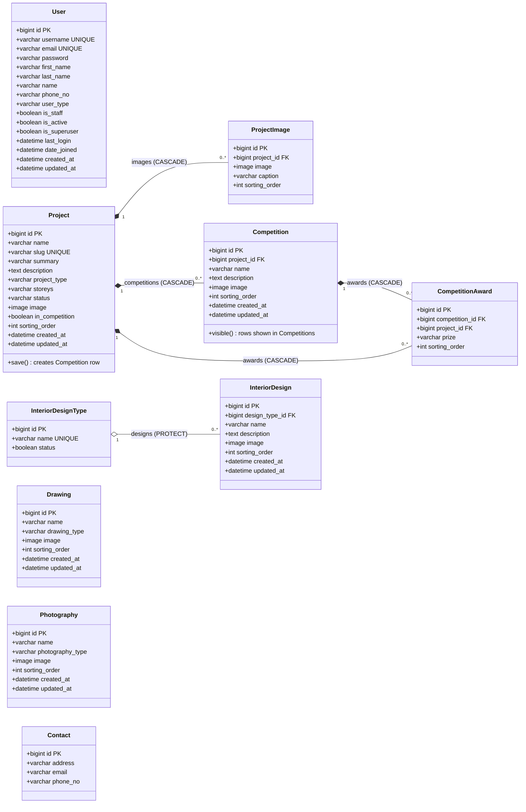
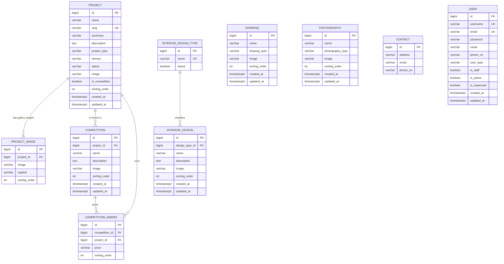
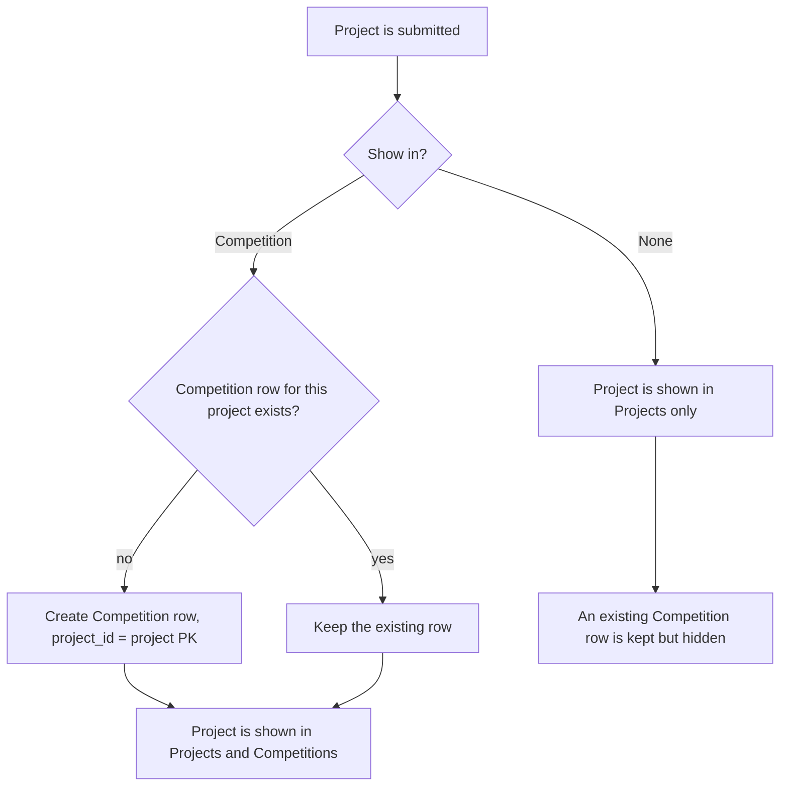

# Layers of Time

Portfolio website for an architecture studio.

- **Backend**: Django + Django REST Framework, PostgreSQL (`backend/`)
- **Frontend**: React + Vite (`frontend/`)
- **Database models**: `backend/api/models.py`

This file documents the full database design.

> The diagrams are written in Mermaid. They render on GitHub, and in VS Code with the
> "Markdown Preview Mermaid Support" extension.

---

## 1. UML class diagram

Each box is one table. `+` fields are columns, the lines are the foreign keys.



`User`, `Drawing`, `Photography` and `Contact` stand alone: they have no foreign key to another table.

---

## 2. ER diagram

The same design in database (crow's foot) notation.



---

## 3. Foreign keys

| Table | Column | Points to | When the parent is deleted |
|---|---|---|---|
| `api_projectimage` | `project_id` | `api_project.id` | Image rows are deleted too (CASCADE) |
| `api_competition` | `project_id` | `api_project.id` | Competition rows are deleted too (CASCADE) |
| `api_competitionaward` | `competition_id` | `api_competition.id` | Award rows are deleted too (CASCADE) |
| `api_competitionaward` | `project_id` | `api_project.id` | Award rows are deleted too (CASCADE) |
| `api_interiordesign` | `design_type_id` | `lkp_interior_design_type.id` | Delete is refused while a design uses the type (PROTECT) |

---

## 4. Tables

Every table has an auto-increment `id bigint` primary key.
Image columns store the file path (`varchar(100)`); the files live in `backend/media/`.

### `api_project` (Project)

| Column | Type | Null | Notes |
|---|---|---|---|
| `id` | bigint | no | PK |
| `name` | varchar(200) | no | |
| `slug` | varchar(220) | no | UNIQUE; used in the URL `/projects/<slug>` |
| `summary` | varchar(400) | no | one-line teaser |
| `description` | text | no | |
| `project_type` | varchar(100) | no | e.g. "Residential" |
| `storeys` | varchar(50) | no | e.g. "G + 4" |
| `status` | varchar(30) | no | `concept`, `design_proposal`, `under_construction`, `completed` |
| `image` | varchar(100) | yes | cover image; required in forms, image files only |
| `in_competition` | boolean | no | default `false`; the "Show in: Competition / None" buttons |
| `sorting_order` | integer | no | lower = shown first |
| `created_at`, `updated_at` | timestamptz | no | set automatically |

### `api_projectimage` (ProjectImage)

| Column | Type | Null | Notes |
|---|---|---|---|
| `id` | bigint | no | PK |
| `project_id` | bigint | no | FK → `api_project.id` |
| `image` | varchar(100) | no | gallery image; image files only |
| `caption` | varchar(200) | no | may be empty |
| `sorting_order` | integer | no | |

### `api_competition` (Competition)

| Column | Type | Null | Notes |
|---|---|---|---|
| `id` | bigint | no | PK |
| `project_id` | bigint | yes | FK → `api_project.id`; required in forms |
| `name` | varchar(200) | no | |
| `description` | text | no | may be empty |
| `image` | varchar(100) | yes | |
| `sorting_order` | integer | no | |
| `created_at`, `updated_at` | timestamptz | no | |

### `api_competitionaward` (CompetitionAward)

| Column | Type | Null | Notes |
|---|---|---|---|
| `id` | bigint | no | PK |
| `competition_id` | bigint | no | FK → `api_competition.id` |
| `project_id` | bigint | no | FK → `api_project.id` |
| `prize` | varchar(100) | no | e.g. "1st Prize" |
| `sorting_order` | integer | no | |

UNIQUE (`competition_id`, `project_id`): a project can win only once per competition.

### `lkp_interior_design_type` (InteriorDesignType)

| Column | Type | Null | Notes |
|---|---|---|---|
| `id` | bigint | no | PK |
| `name` | varchar(100) | no | UNIQUE |
| `status` | boolean | no | `true` = active |

### `api_interiordesign` (InteriorDesign)

| Column | Type | Null | Notes |
|---|---|---|---|
| `id` | bigint | no | PK |
| `design_type_id` | bigint | no | FK → `lkp_interior_design_type.id` |
| `name` | varchar(200) | no | |
| `description` | text | no | may be empty |
| `image` | varchar(100) | yes | |
| `sorting_order` | integer | no | |
| `created_at`, `updated_at` | timestamptz | no | |

### `api_drawing` (Drawing)

| Column | Type | Null | Notes |
|---|---|---|---|
| `id` | bigint | no | PK |
| `name` | varchar(200) | no | |
| `drawing_type` | varchar(20) | no | `watercolour`, `ink_wash`, `pen_studies`, `concept` |
| `image` | varchar(100) | yes | |
| `sorting_order` | integer | no | |
| `created_at`, `updated_at` | timestamptz | no | |

### `api_photography` (Photography)

| Column | Type | Null | Notes |
|---|---|---|---|
| `id` | bigint | no | PK |
| `name` | varchar(200) | no | |
| `photography_type` | varchar(20) | no | `colour`, `monochrome` |
| `image` | varchar(100) | yes | |
| `sorting_order` | integer | no | |
| `created_at`, `updated_at` | timestamptz | no | |

### `api_contact` (Contact)

| Column | Type | Null | Notes |
|---|---|---|---|
| `id` | bigint | no | PK |
| `address` | varchar(300) | no | |
| `email` | varchar(254) | no | |
| `phone_no` | varchar(30) | no | |

### `api_user` (User)

Django's built-in user plus three extra columns.

| Column | Type | Null | Notes |
|---|---|---|---|
| `id` | bigint | no | PK |
| `username` | varchar(150) | no | UNIQUE |
| `email` | varchar(254) | no | UNIQUE |
| `password` | varchar(128) | no | stored hashed |
| `first_name`, `last_name` | varchar(150) | no | may be empty |
| `name` | varchar(150) | no | extra column; may be empty |
| `phone_no` | varchar(20) | no | extra column; may be empty |
| `user_type` | varchar(10) | no | extra column; `admin` or `editor` |
| `is_staff`, `is_active`, `is_superuser` | boolean | no | |
| `last_login` | timestamptz | yes | |
| `date_joined`, `created_at`, `updated_at` | timestamptz | no | |

---

## 5. Rules built on top of the tables

**Project form (`/admin/api/project/add/`)**

- Every field must be filled in before the project is saved.
- The cover image and gallery images accept image files only: jpg, jpeg, png, gif, webp, bmp.
- Several gallery images can be uploaded at once in the "Project images" section.

**Project → Competition**



- Deleting a project deletes its Competition rows and their awards.
- Deleting a competition does not delete the project.

---

## 6. Run it locally

```bash
# backend  (needs PostgreSQL and backend/.env, copied from .env.example)
cd backend
venv\Scripts\activate
python manage.py migrate
python manage.py runserver        # http://127.0.0.1:8000  (admin: /admin/)

# frontend
cd frontend
npm install
npm run dev                       # http://localhost:5173
```
