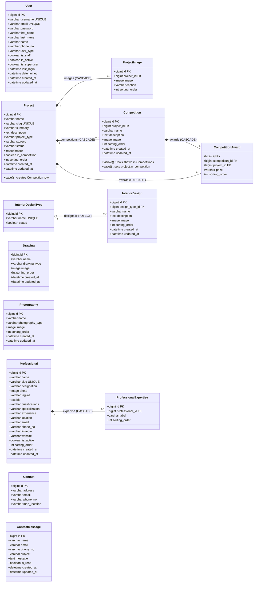
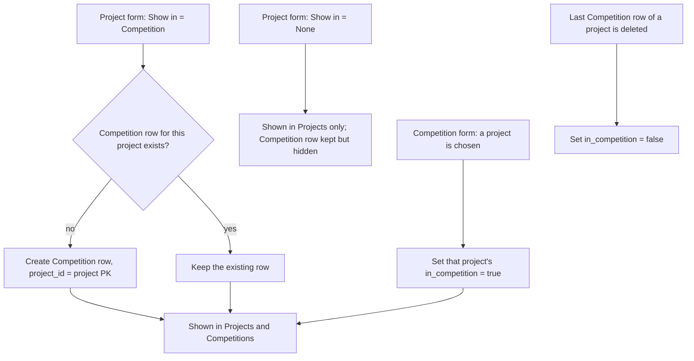

# Layers of Time

Portfolio website for an architecture studio: a public site plus a custom admin dashboard the
studio uses to manage its own content.

| | |
|---|---|
| **Backend** | Django 6.1 + Django REST Framework, PostgreSQL, SimpleJWT — `backend/` |
| **Frontend** | React 19 + Vite 8 + React Router 7 — `layersoftime-main/` |
| **Database models** | `backend/api/models.py` |
| **API routes** | `backend/api/urls.py` |

The frontend is a single React app serving two things: the public pages, and the admin dashboard
under `/admin`. Django's own admin at `http://127.0.0.1:8000/admin/` stays available as a fallback.

> The diagrams below are written in Mermaid. They render on GitHub, and in VS Code with the
> "Markdown Preview Mermaid Support" extension.

---

## 1. Repository layout

```
backend/
  api/
    models.py        every table (see §6)
    serializers.py   JSON shape of each model
    views.py         one ModelViewSet per resource + auth endpoints
    urls.py          router registrations and nested routes
    admin.py         Django admin: multi-image upload, inlines, row delete buttons
    migrations/      0001 … 0013
  main/settings.py   database, DRF, JWT, CORS, media
  media/             uploaded images (projects/, drawings/, photography/, interiors/,
                     competitions/, professionals/)
  .env               local secrets — copied from .env.example, never committed

layersoftime-main/
  src/
    App.jsx          all routes, public and admin
    pages/           public pages
    components/      Layout (nav + footer), PageHeader, Gallery, Lightbox, Reveal
    hooks/useContent.js   public data fetching + the contact-form submit
    admin/
      api.js         the whole admin API client, incl. snake_case ↔ camelCase mapping
      resources.js   declarative config for each CRUD screen
      ResourcePage.jsx  the generic list + add/edit/delete screen built from that config
      AuthContext.jsx, AdminLayout.jsx, Login.jsx, Dashboard.jsx,
      Messages.jsx, ContactSettings.jsx, ChangePassword.jsx
    data.js          static fallbacks (studio name, nav copy, drawing medium labels)
    styles.css       public site styles
  .env               VITE_API_URL=http://localhost:8000
```

The project was started from a Cloudflare template (a Worker + D1 backend, with a `wrangler.jsonc`,
SQL migrations and a mock API). Django replaced all of it, and those files have been removed —
the frontend is now a plain Vite + React app that talks to the Django API over `VITE_API_URL`.
There is no Cloudflare deploy path any more.

> **Note on git:** the repository still tracks an earlier, abandoned frontend under `frontend/` —
> a different React app (its own `api/`, `features/`, `layout/`, CSS modules and tests), not an
> older copy of this one. It is preserved in commit `46c0bb7` but deleted from the working tree,
> so `git status` shows it as deleted and shows `layersoftime-main/` as untracked. Run
> `git add -A` and commit to make the history match the filesystem.

---

## 2. Run it locally

**Backend** — needs PostgreSQL running and a database named `layersoftime`.

```bash
cd backend
cp .env.example .env              # then edit it: SECRET_KEY, DB_PASSWORD, …
venv\Scripts\activate             # Windows; source venv/bin/activate elsewhere
pip install -r requirements.txt
python manage.py migrate
python manage.py createsuperuser  # see the note below
python manage.py runserver        # http://127.0.0.1:8000
```

**Frontend**

```bash
cd layersoftime-main
npm install
npm run dev                       # http://localhost:5173
```

Vite takes the next free port if 5173 is busy (5174, 5175, …). The backend only accepts browser
requests from origins listed in `CORS_ALLOWED_ORIGINS` in `backend/.env`, which currently covers
5173–5179 — add the port if you land outside that range.

### Getting into the dashboard

`createsuperuser` sets `is_staff` and `is_superuser` but leaves `user_type` at its default,
`editor`. The dashboard accepts either signal (`is_staff`, `is_superuser`, or
`user_type == "admin"`), so a superuser can sign in at `/admin/login` as-is. To make the role
explicit, set `user_type` to `admin` on the user in Django admin. Forgotten password:
`python manage.py changepassword <username>`.

### Useful URLs

| URL | What it is |
|---|---|
| `http://localhost:5173/` | public site |
| `http://localhost:5173/admin/login` | dashboard sign-in |
| `http://127.0.0.1:8000/admin/` | Django admin |
| `http://127.0.0.1:8000/api/docs/` | Swagger UI (drf-spectacular) |
| `http://127.0.0.1:8000/api/schema/` | OpenAPI schema |

---

## 3. Site map

**Public** (`src/pages/`, all wrapped in `components/Layout.jsx`, which builds the header, mobile
menu and footer from one `nav` array)

| Route | Page |
|---|---|
| `/` | Home |
| `/projects` · `/projects/:slug` | Projects, project detail |
| `/drawings` | Drawings |
| `/photography` | Photography |
| `/interior-design` | Interior Design |
| `/competitions` | Competitions |
| `/team` | Our Professionals |
| `/contact` | Contact — details, Google map, "Send us a message" form |

**Dashboard** (`src/admin/`, behind `AuthProvider` → `AdminLayout`, which redirects anyone who is
not an admin)

| Route | Screen |
|---|---|
| `/admin` | Dashboard (counts and shortcuts) |
| `/admin/projects` | Projects — cover image + gallery |
| `/admin/drawings` · `/admin/photography` | Drawings, Photography |
| `/admin/interior-designs` | Interior Designs |
| `/admin/competitions` | Competitions — optional link to a project |
| `/admin/team` | Our Professionals — full profiles + expertise list |
| `/admin/messages` | Inbox for contact-form submissions |
| `/admin/contact` | Studio contact details and map pin |
| `/admin/password` | Change password |

Six of those screens are the same component. `ResourcePage.jsx` renders a list, an add/edit modal
and a delete confirmation from a config object in `resources.js`; a config lists its fields with a
type (`text`, `textarea`, `select`, `dynamic-select`, `image`, `gallery`, `taglist`, `checkbox`)
and the functions that map a row to and from the API. `imageLayout: true` splits the form into a
fields column and an image column. Adding a CRUD screen means adding a config and a route, not a
new page.

---

## 4. REST API

Base URL `http://127.0.0.1:8000/api/`. No pagination — endpoints return full lists and the
frontend paginates client-side.

| Endpoint | Methods | Who |
|---|---|---|
| `projects/` · `projects/<id>/` | GET, POST, PUT, PATCH, DELETE | read: anyone · write: signed in |
| `projects/<id>/images/` · `…/<img_id>/` | GET, POST, DELETE | signed in |
| `drawings/`, `photography/` | GET + write | read: anyone · write: signed in |
| `interior-design-types/`, `interior-designs/` | GET + write | read: anyone · write: signed in |
| `competitions/` | GET + write | read: anyone · write: signed in |
| `professionals/` · `professionals/<id>/expertise/` | GET + write | expertise: signed in |
| `contacts/` | GET, PUT, PATCH | read: anyone · write: signed in |
| `contact-messages/` | **POST: anyone** · GET/PATCH/DELETE: signed in | see below |
| `users/` | all | signed in |
| `auth/token/` · `auth/token/refresh/` | POST | anyone |
| `auth/me/` | GET | signed in |
| `auth/change-password/` | POST | signed in |

Defaults in `settings.py`: `IsAuthenticatedOrReadOnly` plus JWT bearer authentication. Two
endpoints deviate deliberately:

- **`contact-messages/`** — anonymous `POST` is allowed so visitors can send the form, but
  **`GET` requires authentication**: the list holds visitors' names, emails and phone numbers and
  must not be publicly readable. `is_read` is forced to `false` on create, so a submission can
  never arrive pre-marked as read.
- **`competitions/`** — the list is `Competition.visible()`, not every row (see §7).

Filtering and search come from django-filter and DRF's `SearchFilter`, e.g.
`/api/projects/?status=completed`, `/api/professionals/?is_active=true`,
`/api/contact-messages/?is_read=false`, `/api/drawings/?search=watercolour`.

Writes that include a file are sent as `multipart/form-data`. `src/admin/api.js` sends `PUT` when
a new file is attached and `PATCH` when none is, so an edit that touches only text never clears an
existing image.

---

## 5. Images

Image columns store a path (`varchar(100)`); the files live under `backend/media/` and are served
by Django itself while `DEBUG=True`.

Project and professional uploads are validated twice: `validate_image_extension` restricts the
extension to jpg, jpeg, png, gif, webp or bmp, and `ImageField` then opens the file with Pillow —
so a PDF renamed `photo.jpg` is rejected too.

In the dashboard, single images use a click-to-upload drop zone with a live preview, and a
project's gallery is a tile grid with an inline `+` tile that accepts several files at once. In
Django admin, the "Project images" inline takes a multi-select upload.

---

## 6. Database design

### 6.1 UML class diagram

Each box is one table. `+` fields are columns, the lines are the foreign keys.



`User`, `Drawing`, `Photography`, `Contact` and `ContactMessage` stand alone: they have no foreign
key to another table.

### 6.2 ER diagram

The same design in database (crow's foot) notation.

```mermaid
erDiagram
    PROJECT ||--o{ PROJECT_IMAGE : "has gallery images"
    PROJECT ||--o{ COMPETITION : "is shown in"
    COMPETITION ||--o{ COMPETITION_AWARD : "gives"
    PROJECT ||--o{ COMPETITION_AWARD : "wins"
    INTERIOR_DESIGN_TYPE ||--o{ INTERIOR_DESIGN : "classifies"
    PROFESSIONAL ||--o{ PROFESSIONAL_EXPERTISE : "lists"

    PROJECT {
        bigint id PK
        varchar name
        varchar slug UK
        varchar summary
        text description
        varchar project_type
        varchar storeys
        varchar status
        varchar image
        boolean in_competition
        int sorting_order
        timestamptz created_at
        timestamptz updated_at
    }
    PROJECT_IMAGE {
        bigint id PK
        bigint project_id FK
        varchar image
        varchar caption
        int sorting_order
    }
    COMPETITION {
        bigint id PK
        bigint project_id FK
        varchar name
        text description
        varchar image
        int sorting_order
        timestamptz created_at
        timestamptz updated_at
    }
    COMPETITION_AWARD {
        bigint id PK
        bigint competition_id FK
        bigint project_id FK
        varchar prize
        int sorting_order
    }
    INTERIOR_DESIGN_TYPE {
        bigint id PK
        varchar name UK
        boolean status
    }
    INTERIOR_DESIGN {
        bigint id PK
        bigint design_type_id FK
        varchar name
        text description
        varchar image
        int sorting_order
        timestamptz created_at
        timestamptz updated_at
    }
    DRAWING {
        bigint id PK
        varchar name
        varchar drawing_type
        varchar image
        int sorting_order
        timestamptz created_at
        timestamptz updated_at
    }
    PHOTOGRAPHY {
        bigint id PK
        varchar name
        varchar photography_type
        varchar image
        int sorting_order
        timestamptz created_at
        timestamptz updated_at
    }
    PROFESSIONAL {
        bigint id PK
        varchar name
        varchar slug UK
        varchar designation
        varchar photo
        varchar tagline
        text bio
        varchar qualifications
        varchar specialization
        varchar experience
        varchar location
        varchar email
        varchar phone_no
        varchar linkedin
        varchar website
        boolean is_active
        int sorting_order
        timestamptz created_at
        timestamptz updated_at
    }
    PROFESSIONAL_EXPERTISE {
        bigint id PK
        bigint professional_id FK
        varchar label
        int sorting_order
    }
    CONTACT {
        bigint id PK
        varchar address
        varchar email
        varchar phone_no
        varchar map_location
    }
    CONTACT_MESSAGE {
        bigint id PK
        varchar name
        varchar email
        varchar phone_no
        varchar subject
        text message
        boolean is_read
        timestamptz created_at
        timestamptz updated_at
    }
    USER {
        bigint id PK
        varchar username UK
        varchar email UK
        varchar password
        varchar name
        varchar phone_no
        varchar user_type
        boolean is_staff
        boolean is_active
        boolean is_superuser
        timestamptz created_at
        timestamptz updated_at
    }
```



### 6.3 Foreign keys

| Table | Column | Points to | When the parent is deleted |
|---|---|---|---|
| `api_projectimage` | `project_id` | `api_project.id` | Image rows are deleted too (CASCADE) |
| `api_competition` | `project_id` | `api_project.id` | Competition rows are deleted too (CASCADE) |
| `api_competitionaward` | `competition_id` | `api_competition.id` | Award rows are deleted too (CASCADE) |
| `api_competitionaward` | `project_id` | `api_project.id` | Award rows are deleted too (CASCADE) |
| `api_interiordesign` | `design_type_id` | `lkp_interior_design_type.id` | Delete is refused while a design uses the type (PROTECT) |
| `api_professionalexpertise` | `professional_id` | `api_professional.id` | Expertise rows are deleted too (CASCADE) |

### 6.4 Tables

Every table has an auto-increment `id bigint` primary key.
Image columns store the file path (`varchar(100)`); the files live in `backend/media/`.

#### `api_project` (Project)

| Column | Type | Null | Notes |
|---|---|---|---|
| `name` | varchar(200) | no | |
| `slug` | varchar(220) | no | UNIQUE; built from `name`, used in the URL `/projects/<slug>` |
| `summary` | varchar(400) | no | one-line teaser |
| `description` | text | no | a blank line starts a new paragraph |
| `project_type` | varchar(100) | no | e.g. "Residential" |
| `storeys` | varchar(50) | no | e.g. "G + 4" |
| `status` | varchar(30) | no | `concept`, `design_proposal`, `under_construction`, `completed` |
| `image` | varchar(100) | yes | cover image; required in forms, image files only |
| `in_competition` | boolean | no | default `false`; the "Show in: Competition / None" choice |
| `sorting_order` | integer | no | lower = shown first |
| `created_at`, `updated_at` | timestamptz | no | set automatically |

Ordered by `sorting_order`, then newest first.

#### `api_projectimage` (ProjectImage)

| Column | Type | Null | Notes |
|---|---|---|---|
| `project_id` | bigint | no | FK → `api_project.id` |
| `image` | varchar(100) | no | gallery image; image files only |
| `caption` | varchar(200) | no | may be empty |
| `sorting_order` | integer | no | |

#### `api_competition` (Competition)

| Column | Type | Null | Notes |
|---|---|---|---|
| `project_id` | bigint | yes | FK → `api_project.id`; optional — empty means a standalone entry |
| `name` | varchar(200) | no | |
| `description` | text | no | may be empty |
| `image` | varchar(100) | yes | |
| `sorting_order` | integer | no | |
| `created_at`, `updated_at` | timestamptz | no | |

#### `api_competitionaward` (CompetitionAward)

| Column | Type | Null | Notes |
|---|---|---|---|
| `competition_id` | bigint | no | FK → `api_competition.id` |
| `project_id` | bigint | no | FK → `api_project.id` |
| `prize` | varchar(100) | no | e.g. "1st Prize" |
| `sorting_order` | integer | no | |

UNIQUE (`competition_id`, `project_id`): a project can win only once per competition.

#### `lkp_interior_design_type` (InteriorDesignType)

| Column | Type | Null | Notes |
|---|---|---|---|
| `name` | varchar(100) | no | UNIQUE |
| `status` | boolean | no | `true` = active / selectable |

The table name is kept from the original design sketch via `db_table`.

#### `api_interiordesign` (InteriorDesign)

| Column | Type | Null | Notes |
|---|---|---|---|
| `design_type_id` | bigint | no | FK → `lkp_interior_design_type.id` (PROTECT) |
| `name` | varchar(200) | no | |
| `description` | text | no | may be empty |
| `image` | varchar(100) | yes | |
| `sorting_order` | integer | no | |
| `created_at`, `updated_at` | timestamptz | no | |

#### `api_drawing` (Drawing)

| Column | Type | Null | Notes |
|---|---|---|---|
| `name` | varchar(200) | no | |
| `drawing_type` | varchar(20) | no | `watercolour`, `ink_wash`, `pen_studies`, `concept` |
| `image` | varchar(100) | yes | |
| `sorting_order` | integer | no | |
| `created_at`, `updated_at` | timestamptz | no | |

#### `api_photography` (Photography)

| Column | Type | Null | Notes |
|---|---|---|---|
| `name` | varchar(200) | no | |
| `photography_type` | varchar(20) | no | `colour`, `monochrome` |
| `image` | varchar(100) | yes | |
| `sorting_order` | integer | no | |
| `created_at`, `updated_at` | timestamptz | no | |

#### `api_professional` (Professional)

One row is one full profile section on the Our Professionals page.

| Column | Type | Null | Notes |
|---|---|---|---|
| `name` | varchar(150) | no | |
| `slug` | varchar(170) | no | UNIQUE; built from `name` |
| `designation` | varchar(150) | no | e.g. "Principal Architect" |
| `photo` | varchar(100) | yes | portrait; image files only. Empty falls back to a monogram |
| `tagline` | varchar(250) | no | short line under the name |
| `bio` | text | no | a blank line starts a new paragraph |
| `qualifications` | varchar(300) | no | e.g. "B.Arch (BUET), M.Arch (NUS)" |
| `specialization` | varchar(300) | no | |
| `experience` | varchar(100) | no | e.g. "12 years" |
| `location` | varchar(150) | no | |
| `email` | varchar(254) | no | may be empty |
| `phone_no` | varchar(30) | no | may be empty |
| `linkedin`, `website` | varchar(200) | no | may be empty |
| `is_active` | boolean | no | default `true`; `false` hides the person from the public page |
| `sorting_order` | integer | no | the order the sections appear in |
| `created_at`, `updated_at` | timestamptz | no | |

Everything except `name` and `designation` may be left blank — the public page renders only the
fields that are filled in.

#### `api_professionalexpertise` (ProfessionalExpertise)

One bullet in a professional's "Areas of expertise" list.

| Column | Type | Null | Notes |
|---|---|---|---|
| `professional_id` | bigint | no | FK → `api_professional.id` |
| `label` | varchar(120) | no | |
| `sorting_order` | integer | no | |

#### `api_contact` (Contact)

A single row holding the studio's contact details.

| Column | Type | Null | Notes |
|---|---|---|---|
| `address` | varchar(300) | no | the address shown to readers |
| `email` | varchar(254) | no | |
| `phone_no` | varchar(30) | no | |
| `map_location` | varchar(300) | no | what the map pin points at — `"lat,lng"` or a place name. Empty = search for `address` |

#### `api_contactmessage` (ContactMessage)

One submission from the Contact page form.

| Column | Type | Null | Notes |
|---|---|---|---|
| `name` | varchar(150) | no | required, non-blank |
| `email` | varchar(254) | no | required, non-blank |
| `phone_no` | varchar(30) | no | may be empty |
| `subject` | varchar(200) | no | may be empty |
| `message` | text | no | required, non-blank |
| `is_read` | boolean | no | default `false`; set from the dashboard inbox |
| `created_at`, `updated_at` | timestamptz | no | |

Ordered newest first.

#### `api_user` (User)

Django's built-in user plus three extra columns.

| Column | Type | Null | Notes |
|---|---|---|---|
| `username` | varchar(150) | no | UNIQUE |
| `email` | varchar(254) | no | UNIQUE (made unique on top of `AbstractUser`) |
| `password` | varchar(128) | no | stored hashed |
| `first_name`, `last_name` | varchar(150) | no | may be empty |
| `name` | varchar(150) | no | extra column; may be empty |
| `phone_no` | varchar(20) | no | extra column; may be empty |
| `user_type` | varchar(10) | no | extra column; `admin` or `editor` (default `editor`) |
| `is_staff`, `is_active`, `is_superuser` | boolean | no | |
| `last_login` | timestamptz | yes | |
| `date_joined`, `created_at`, `updated_at` | timestamptz | no | |

---

## 7. Rules built on top of the tables

### Project ↔ Competition

A project appears in the Competitions section when `in_competition` is `true`. That flag and the
`Competition` rows are kept in step from **both** directions, so either form can be used:



- `Project.save()` creates a `Competition` row the first time "Competition" is chosen, copying the
  project's name, summary and cover image.
- `Competition.save()` does the mirror image: picking a project sets that project's
  `in_competition` to `true`. Without this the row would be filtered straight back out by
  `visible()` and vanish the moment it was saved. It uses `update()` rather than `project.save()`
  so `Project.save()` does not run and add a second row.
- `Competition.visible()` is what the API serves: rows whose project chose "Competition", plus
  rows with no project at all (standalone entries).
- A `post_delete` receiver clears `in_competition` when a project's last `Competition` row goes,
  so a project never claims to be in a section that shows nothing.
- Deleting a project deletes its competition rows and their awards. Deleting a competition does
  not delete the project.

### Project form

- Every field must be filled in before a project is saved (enforced in `ProjectAdminForm` and in
  the dashboard form).
- Cover and gallery images accept image files only: jpg, jpeg, png, gif, webp, bmp.
- Several gallery images can be uploaded at once.

### Our Professionals

The public page renders one section per active professional, alternating the portrait left and
right, with a jump-to index when there are two or more people. Expertise bullets live in their own
table; the dashboard edits them as a chip list and `syncExpertise()` diffs the submitted labels
against what the server holds, deleting what was removed and posting what is new.

### Contact

- The map is a keyless Google Maps embed, `https://www.google.com/maps?q=<query>&output=embed`,
  where the query is `map_location` if set and `address` otherwise. Keeping them separate lets the
  pin be precise coordinates while the address stays readable. Google short links
  (`maps.app.goo.gl/…`) must be resolved to coordinates first — the embed cannot follow them.
- The form validates in the browser, then POSTs anonymously to `contact-messages/` and shows a
  confirmation panel. Field errors from the API are mapped back onto the matching inputs.
- Submissions land in `/admin/messages`. Opening one marks it read; it can be marked unread again,
  answered by `mailto:`, or deleted.

---

## 8. Migrations

| | |
|---|---|
| `0001`–`0002` | initial schema, competition awards |
| `0003` | data migration: a sample competition and "1st Prize" award for "Building 1" |
| `0004`–`0005` | project fields made mandatory, images restricted to image files |
| `0006` · `0008`–`0010` | the `Competition.project` foreign key, `in_competition`, its DB default, CASCADE |
| `0007` | data migration: backfills a `Competition` row for every existing project |
| `0011` | `Professional` and `ProfessionalExpertise` |
| `0012` | `ContactMessage` |
| `0013` | `Contact.map_location` |
